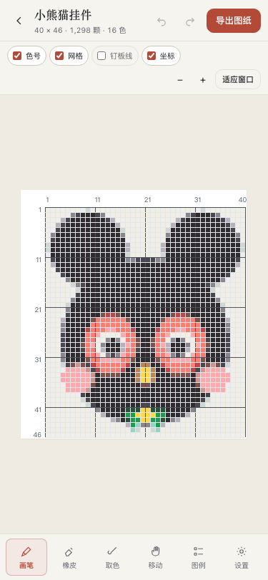

# 拼豆工作室 · Pindou Studio

**上传一张图，得到一张能照着拼、能直接买豆、能打印出来的拼豆图纸。**

纯前端、零依赖、所有处理都在本机完成。桌面与手机浏览器均可使用。

**在线使用：<https://kakarorkaka.github.io/pindou-studio/>**


## 这是什么

把照片 / 插画 / 头像转换成拼豆图纸：

- 每格对应一颗真实可购买的品牌色号（MARD / COCO / 漫漫 / 盼盼 / 咪小窝，205 色）
- 自带行列坐标、每 10 格定位线、29×29 钉板边界线
- 自动生成色号图例与购物清单（每种颜色多少颗）
- 导出 PNG 图纸、100% 缩放打印版、CSV 清单



## 功能

- **三档预设**：速成 24 格 / 标准 40 格 / 精细 64 格，直接显示预计豆数与耗时；也可自定义 8–400 格
- **自动裁白边**：主体周围留白过大时自动裁切，让图案占满图纸（可在高级参数关闭）
- **背景处理**：透明 / 近白背景留空；「仅移除与边缘连通的背景」保留主体内部白色（白衣服、白眼睛）
- **成图质量调节**：盒式平均 / 主导色采样、Lab / CIEDE2000 / RGB 色差、Floyd–Steinberg / Bayer 抖动、BFS 区域合并去杂色
- **实时编辑**：点格上色、长按擦除、取色、撤销 / 重做（20+ 步）
- **颜色排除**：不想要的色号一键排除，其余格子自动重映射到相近色，可撤销 / 全部恢复
- **真实交付**：PNG（16/24/32/48 px 格）、打印（100% 缩放，含打印说明）、CSV 购物清单
- **双端适配**：桌面左侧画布 + 右侧检查器；移动端画布 + 底部工具栏 + 抽屉
- **隐私**：图片不离开浏览器，无网络请求、无账号、无上传


## 快速开始

**方式一：直接打开**

双击 `index.html` 即可（Chrome / Edge / Safari 均支持），离线可用。

**方式二：本地静态服务**

```bash
cd 项目目录
python3 -m http.server 8000
# 打开 http://localhost:8000
```

> 页面会用 `fetch` 加载内置示例图与色号数据，直接用 `file://` 打开时 Chrome 需要允许本地文件访问；Safari 正常。若示例图不显示，用静态服务方式即可。

## 使用方式

1. 上传图片（点击、拖拽、或桌面端 `⌘V` 粘贴），也可以点「用示例图试试」
2. 选择尺寸档 / 豆子品牌 / 颜色数，点「生成图纸」
3. 在工作台里微调：点格改色、橡皮擦、取色、图例排除色号
4. 「导出图纸」选择合适的清晰度，或直接打印 / 导出购物清单

### 鼠标 / 触摸

| 操作 | 桌面 | 手机 |
|------|------|------|
| 上色 | 左键点击 / 拖动 | 单指点按 / 拖动 |
| 擦除 | 右键 / `E` | 长按 450ms / 橡皮工具 |
| 取色 | `I` / 工具 | 取色工具 |
| 平移 | 空格 + 拖动 / 移动工具 | 双指拖动 |
| 缩放 | 滑杆、`+/-`、`⌘` + 滚轮 | 双指捏合 |
| 适应窗口 | `F` / 按钮 | 按钮 |

### 快捷键（桌面）

`B` 画笔 · `E` 橡皮 · `I` 取色 · `H` 移动 · `F` 适应窗口 · `G` 网格 · `⌘Z` 撤销 · `⇧⌘Z` 重做 · `⌘E` 导出

## 工作原理

1. **采样**：分级缩放把图片缩到 2× 网格，再按 2×2 盒式平均（或取每格主导色）
2. **留空**：按不透明度覆盖率剔除透明区域；近白区域可只剔除与边缘连通的部分；可选自动裁白边
3. **聚类**：中位切分按「色域 × 用量」切出候选色簇 → 2 轮 Lab 空间 Lloyd 微调 → 匹配最近品牌色号 → 相近色号两两合并到目标色数（大色块先保住，点缀色存活）
4. **吸附**：逐格吸附到最终色板（Lab / CIEDE2000 / RGB），可选抖动与 BFS 区域合并
5. **渲染**：按用量排序色板，输出带标题栏、坐标、色号、图例、统计的图纸

## 项目结构

```
.
├── index.html            # 页面结构
├── css/styles.css        # 设计系统与响应式样式
├── js/
│   ├── colorData.js      # 205 色 × 5 品牌色号数据
│   ├── engine.js         # 图片 → 网格 → 色号 → 图纸渲染
│   └── app.js            # 交互、状态、导出、自检
├── assets/
│   ├── sample-panda.png  # 内置示例图
│   └── favicon.svg
└── docs/screenshots/     # 界面截图
```

## 浏览器支持

Chrome / Edge 100+、Safari 15.4+、iOS Safari 15.4+、Android Chrome 100+。
依赖 Canvas 2D、`ImageData`、`Pointer Events`、`ResizeObserver`。

## 路线图

- [x] 双端工作台 / 三档预设 / 实时编辑 / 导出 PNG·打印·CSV
- [x] 自动裁白边 / 边界背景移除 / CIEDE2000 / BFS 区域合并
- [ ] AI 风格化预处理（风格库 + 强度控制 + 主体分割，可选模块）
- [ ] 最近作品（本地持久化）与批量处理
- [ ] PDF 分页打印、自定义色板、作品分享卡

## 说明

- 色号数据参考公开品牌色卡整理，**购买前请与实物色卡或店家核对**；不同品牌色号不通用。
- 本项目与任何拼豆品牌无隶属关系。
- 图片处理全部在浏览器完成，不会上传。

## License

MIT
