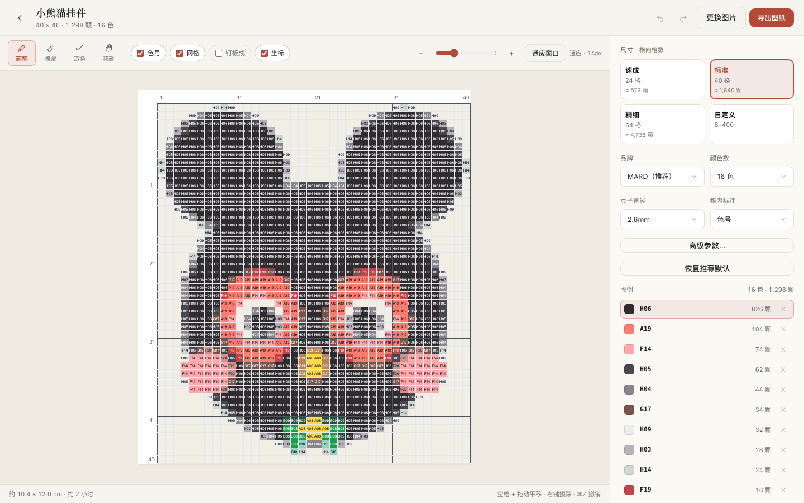
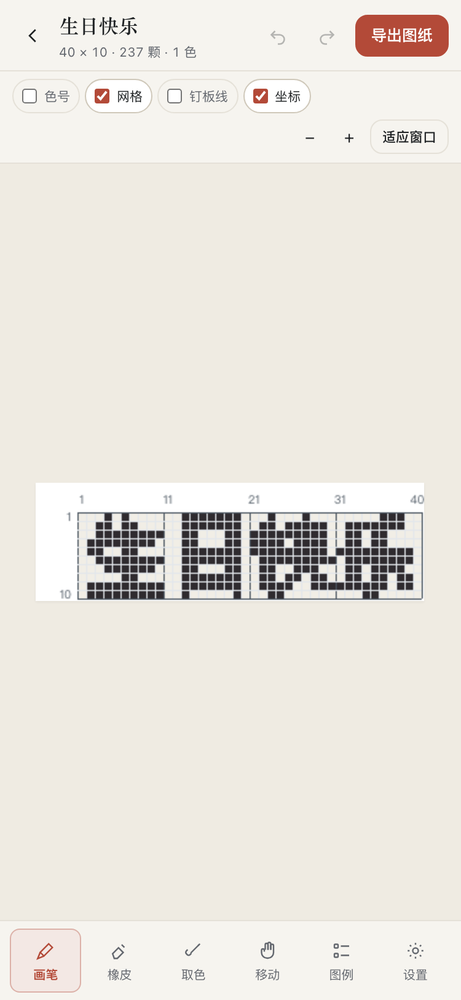
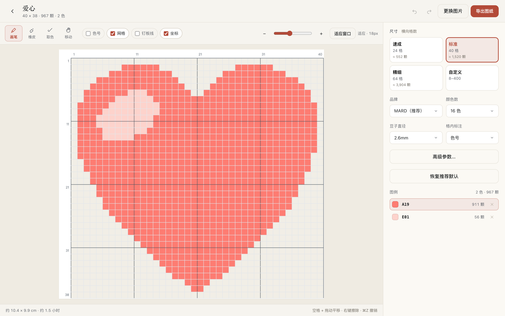
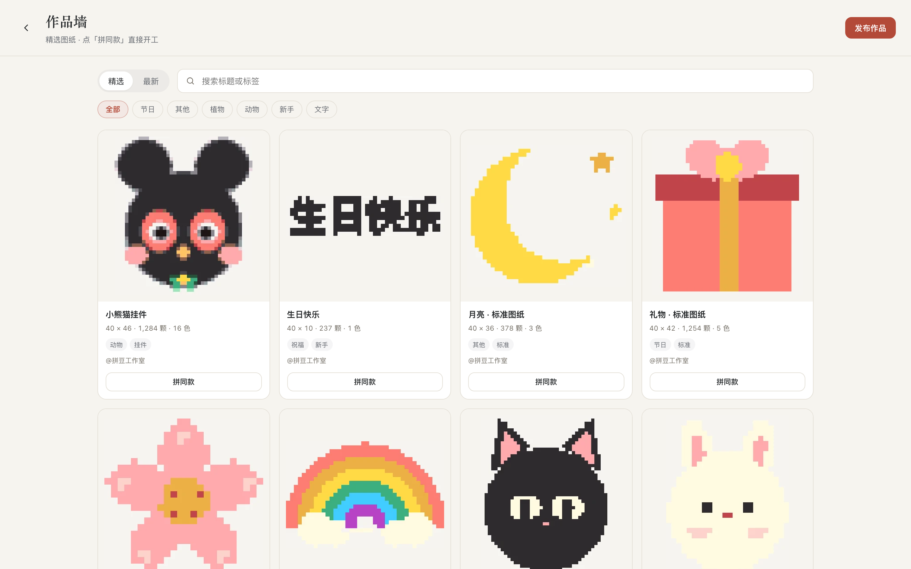
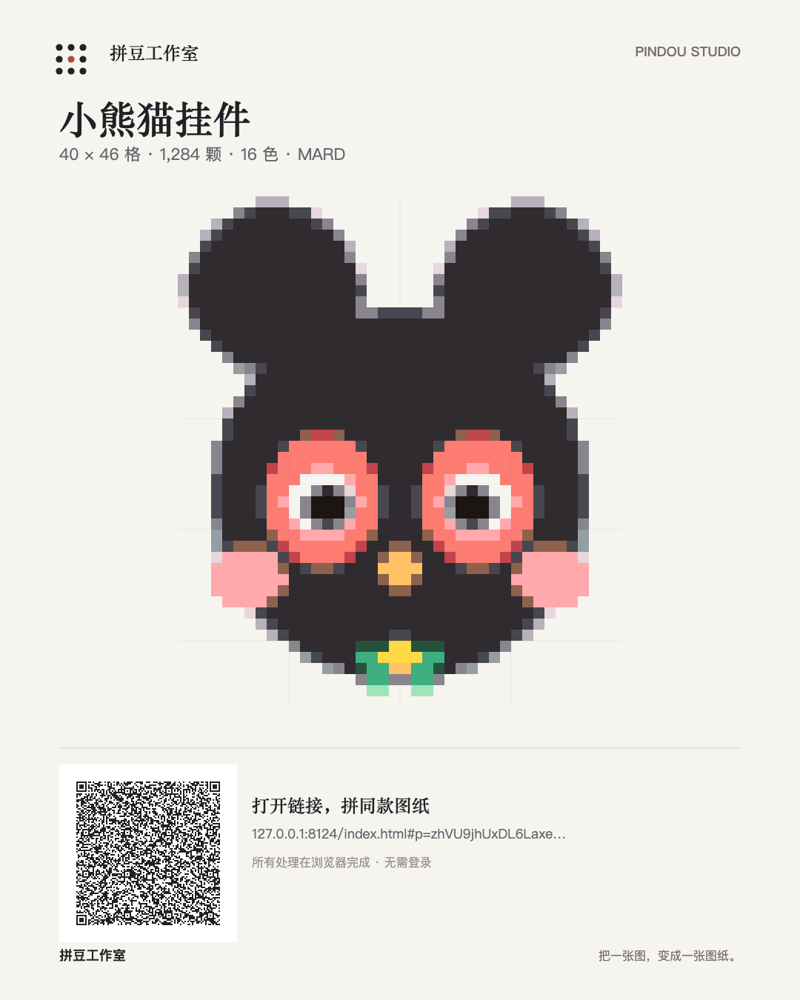
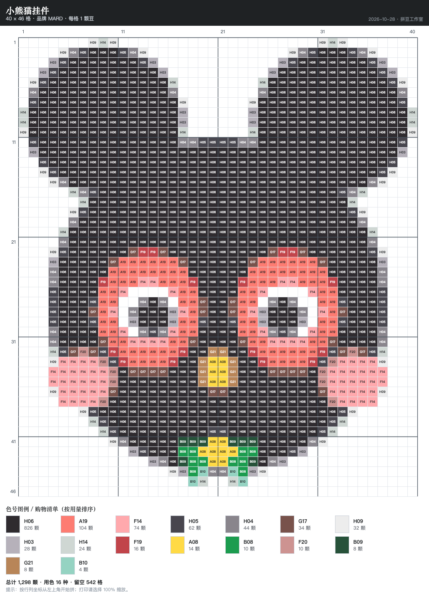

# 拼豆工作室 · Pindou Studio

**把一张图、一句话，变成能照着拼、能直接买豆、能打印出来的拼豆图纸。**

纯前端、零依赖、所有处理在本机完成。桌面与手机浏览器通用，支持离线安装（PWA）。

**在线使用：<https://kakarorkaka.github.io/pindou-studio/>**



## 核心能力

- **三种图纸来源**
  - 图片：照片、插画、头像，自动裁白边与去背景
  - 文字：名字、祝福语，中文 / 英文 / 数字，最多 12 字
  - 模板：爱心、星星、小花、小兔、猫咪、彩虹、樱花、礼物、笑脸、云朵、月亮、蝴蝶（12 个）
- **真实品牌色号**：MARD / COCO / 漫漫 / 盼盼 / 咪小窝，205 色；格内标注、图例、颗数一应俱全
- **可编辑工作台**：点格上色、长按擦除、取色、撤销重做、排除色号自动重映射
- **成图质量**：盒式平均 / 主导色采样、Lab / CIEDE2000 / RGB、Bayer / Floyd–Steinberg 抖动、BFS 区域合并、边界背景移除
- **画面风格**：原图 / 卡通 / 像素 / 剪影（仅图片来源）
- **完整交付**：PNG 图纸（含标题、坐标、色号、图例、统计）、100% 缩放打印、购物清单 CSV
- **分享传播**：分享卡（1080×1350，带二维码）+ 能还原图纸的分享链接（deflate 压缩）
- **本地作品库**：自动保存、最近作品、一键恢复编辑（IndexedDB，仅存本机）
- **作品墙**：精选可拼图纸，点「拼同款」直接载入工作台；支持搜索/分类/收藏
- **发布素材**：分享卡 + 小红书文案 + 二维码；审核制投稿，通过后上墙
- **离线可用**：PWA manifest + Service Worker，可添加到主屏幕
- **隐私**：图片不上传、无账号、无埋点

## 截图

| | |
|---|---|
|  |  |
| 文字转图纸（40 × 10，1 色） | 模板转图纸（爱心，2 色） |
|  |  |
| 作品墙（精选图纸） | 分享卡（含二维码） |



## 快速开始

**直接打开**：双击 `index.html`（Chrome / Edge / Safari 均可）。示例图通过 `fetch` 加载，`file://` 下若示例图不显示，改用下面的静态服务即可。

**本地静态服务**

```bash
cd 项目目录
python3 -m http.server 8000
# 打开 http://localhost:8000
```

**安装为应用（PWA）**

- Chrome / Edge：地址栏右侧安装图标，或菜单 →「安装拼豆工作室 / 添加到主屏幕」
- iOS Safari：分享 →「添加到主屏幕」
- 安装后可离线使用（Service Worker 缓存页面与资源）

## 使用方式

1. 在「图片 / 文字 / 模板」里选择来源
   - 图片：点击、拖拽或 `⌘V` 粘贴；也可以点「用示例图试试」
   - 文字：输入内容、选颜色（可选描边）
   - 模板：点选一个模板
2. 选尺寸档（速成 24 / 标准 40 / 精细 64，或自定义 8–400）、豆子品牌、颜色数
3. 生成后在工作台微调：点格改色、橡皮、取色、图例排除色号
4. 「导出图纸」：PNG / 打印 / CSV；「分享图纸」：分享卡与分享链接

### 鼠标 / 触摸

| 操作 | 桌面 | 手机 |
|------|------|------|
| 上色 | 左键点击 / 拖动 | 单指点按 / 拖动 |
| 擦除 | 右键 / `E` | 长按 450ms / 橡皮工具 |
| 取色 | `I` / 工具 | 取色工具 |
| 平移 | 空格 + 拖动 / 移动工具 | 双指拖动 |
| 缩放 | 滑杆、`+/-`、`⌘` + 滚轮 | 双指捏合 |
| 适应窗口 | `F` / 按钮 | 按钮 |

### 快捷键（桌面）

`B` 画笔 · `E` 橡皮 · `I` 取色 · `H` 移动 · `F` 适应窗口 · `G` 网格 · `⌘Z` 撤销 · `⇧⌘Z` 重做 · `⌘E` 导出

## 工作原理

1. **准备**：图片可自动裁掉白边、按风格滤镜处理；文字与模板做平面化，保证边缘不产生灰阶
2. **留空**：按不透明度与近白判定剔除背景；边界洪水填充可保留主体内部白色；白底图做边缘去灰
3. **聚类**：中位切分按「色域 × 用量」切出候选簇 → 2 轮 Lab Lloyd 微调 → 匹配品牌色号 → 相近色号合并
4. **吸附**：逐格吸附（Lab / CIEDE2000 / RGB），可选抖动与 BFS 区域合并
5. **渲染**：图纸包含标题、坐标、色号、图例、统计；分享卡与分享链接由同一份图纸数据生成

## 项目结构

```
.
├── index.html              # 页面结构（三模式 / 工作台 / 浮层）
├── manifest.webmanifest    # PWA
├── sw.js                   # Service Worker（离线缓存）
├── css/styles.css          # 设计系统与响应式
├── js/
│   ├── colorData.js        # 205 色 × 5 品牌
│   ├── engine.js           # 图片 → 网格 → 色号 → 图纸
│   ├── templates.js        # 内置模板绘制
│   ├── community-works.js  # 作品墙精选数据
│   ├── qrcode.js           # 二维码（MIT, qrcode-generator）
│   ├── share.js            # 分享链接压缩 / 分享卡渲染
│   ├── projects.js         # IndexedDB 作品库
│   └── app.js              # 交互、状态、导出
├── assets/                 # 示例图、图标、favicon、作品缩略图
└── docs/
    ├── product-plan.md     # 产品进阶方案
    ├── community.md        # 作品墙投稿与审核说明
    └── screenshots/        # 界面截图
```

## 作品墙与投稿

作品墙采用**审核制**：在工作台点「导出图纸 → 发布到作品墙」，填写信息并确认权利声明后，会打开 [pindou-community](https://github.com/kakarorkaka/pindou-community/issues/new) 的投稿 Issue；审核通过后加入精选作品墙。

详细审核标准、数据结构与下架规则见 [docs/community.md](docs/community.md)。

## 浏览器支持

Chrome / Edge 100+、Safari 15.4+、iOS Safari 15.4+、Android Chrome 100+。
依赖 Canvas 2D、Pointer Events、IndexedDB、Service Worker（离线）；分享链接压缩优先使用 CompressionStream，不支持时自动退回未压缩编码。

## 说明

- 色号数据参考公开品牌色卡整理，**购买前请与实物色卡或店家核对**；不同品牌色号不通用。
- 本项目与任何拼豆品牌无隶属关系。
- 所有图片处理在浏览器完成，不上传服务器；作品仅保存在本机 IndexedDB，可删除。
- 二维码功能使用 [qrcode-generator](https://github.com/kazuhikoarase/qrcode-generator)（MIT）。

## License

MIT
